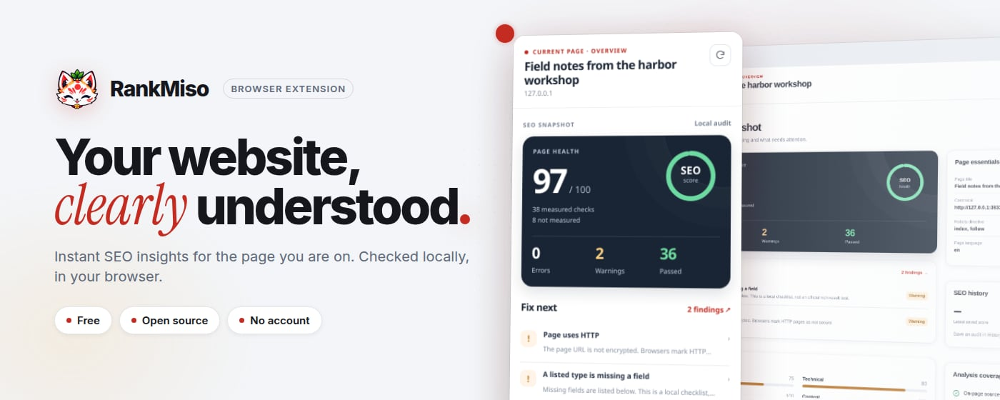
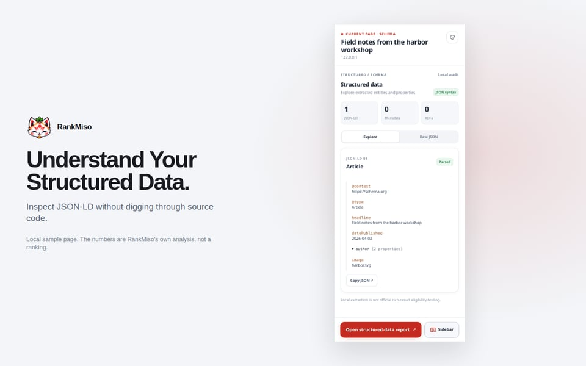
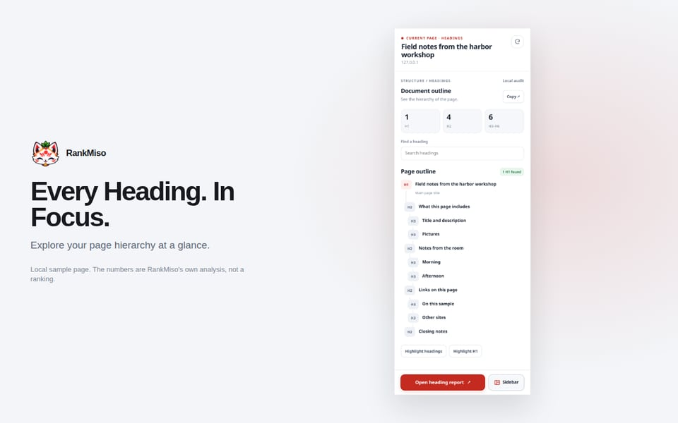
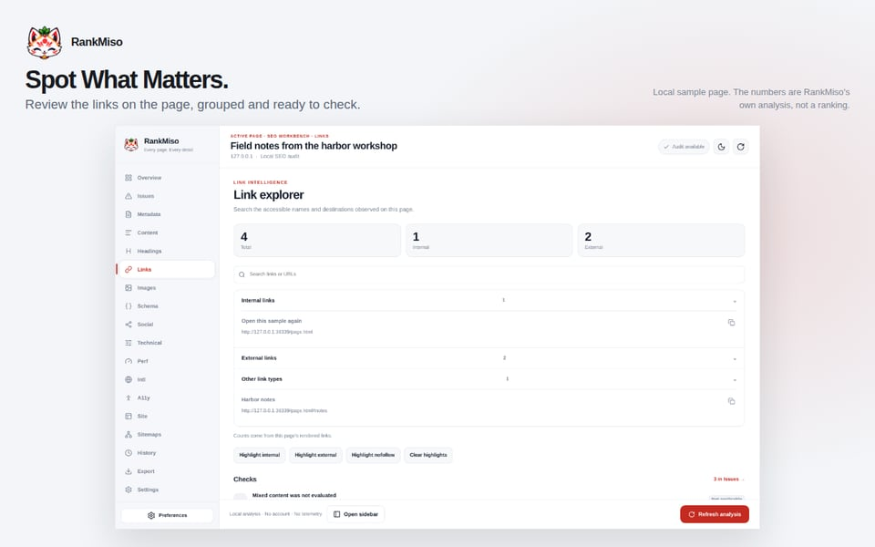
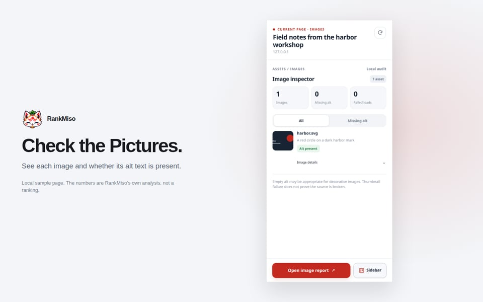
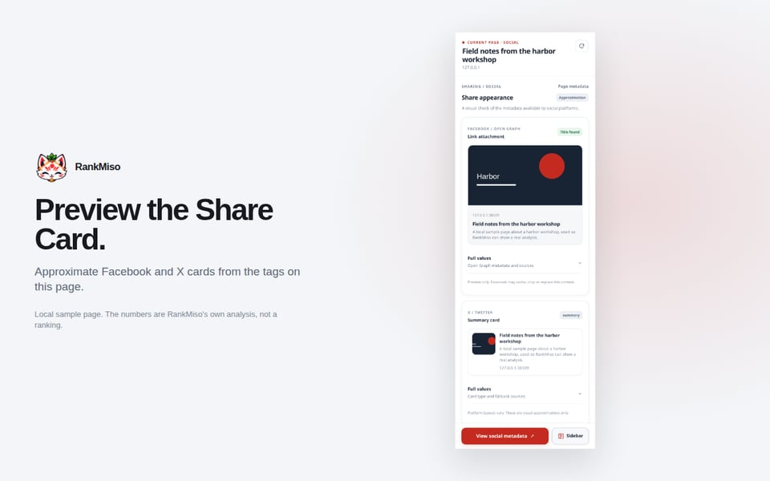
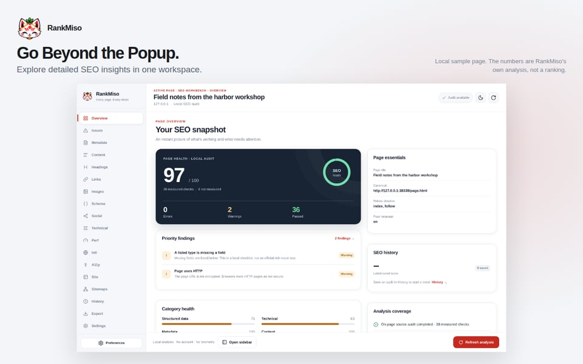

<p align="center">
  <picture>
    <source media="(prefers-color-scheme: dark)" srcset="docs/assets/readme/hero-dark.jpg" />
    
  </picture>
</p>

<h3 align="center">Every page. Every detail.</h3>

<p align="center">
  A free, open-source SEO browser extension with a fox's nose for detail.<br />
  Click the fox, read the page. No account, no subscription, no telemetry, no ads, no backend.
</p>

<p align="center">
  
  
  
  
</p>

---

## 🦊 Meet the fox

RankMiso is for developers, marketers, and anyone who owns a website. Open it on the page you are viewing. It reads that page **in your browser**, scores the checks it can actually measure, and shows the rest as *not measured*. No guessing, no made-up numbers.

<p align="center">
  
</p>

It belongs to the Miso ecosystem, where the recipe is simple: powerful tools, less overhead.

RankMiso is available in the Chrome Web Store and Firefox Add-ons. Edge builds are available for sideloading. Release maintenance notes are in [docs/releases](docs/releases/).

> [!NOTE]
> v0.3.0 remains the published store version. v0.4.0 is being prepared; candidate packages have not been submitted. MCP integration is a future plan; no MCP server or browser bridge is included.

## 🍜 What's in the bowl

The popup is the quick taste. The full report is one click away.

| | |
| --- | --- |
|  |  |
| **JSON-LD.** Labeled fields you can scan, plus a copy of the formatted source. | **Headings.** The whole outline, with copy on each heading. |
|  |  |
| **Links.** Internal, external, and nofollow, with addresses you can open. | **Images.** Thumbnail, bold name, then the image address. |
|  |  |
| **Social.** Approximate link and X cards, including the share image when it loads. | **Full report.** The same analysis, with room for the long tables. |

The **overview** puts the essentials up front: score, title, description, counts, H1, canonical, robots, language, and schema types.

The full report adds metadata, content, technical details, performance observations, international tags, a small accessibility sample, and exports. JSON, CSV, and HTML download only after you confirm.

The little things are handled too. Counts use thousands separators, long addresses truncate, and web links open in a new tab. Light, dark, and system themes are all in the box.

## 🎯 A score you can trust

The number is a weighted summary of the checks that ran. Errors, warnings, and passes are counted. Checks that could not be evaluated stay out of the score, so a missing measurement never sneaks in as a pass.

**The fox's oath.** RankMiso will not invent:

- search volume or keyword difficulty
- traffic or backlinks
- index status

A missing measurement is shown as unavailable. The result includes a disclaimer: this is not a Google ranking.

<details>
<summary><b>Optional checks that reach the network (off until you start them)</b></summary>

<br />

Chromium builds can run explicit optional site checks, sitemap discovery, and Site Explorer. Firefox builds support user-started, same-origin Site Explorer crawling; other optional remote technical checks and standalone sitemap discovery remain unavailable there.

The report also has a Sitemaps section. In Chromium it can read the sitemap files named by robots.txt, two common paths, or a URL you enter, after you allow that site. It does not fetch a sitemap on another host, and it does not crawl the listed pages. Firefox imports XML locally; its Site Explorer can read sitemap URLs only as part of a crawl you explicitly start.

Those requests stay off until you start them. Site Explorer is limited to the selected origin, follows robots.txt, uses bounded page/depth/time/request limits, omits credentials, and stops when requested or when its report closes. Automatic Checks do not start crawls.

The Performance section shows browser-observed LCP and CLS when available, plus an INP estimate from exposed event entries. These are not field data. Chromium builds offer an optional mobile PageSpeed Insights check that sends the page URL and a user-provided API key to Google only after explicit consent; its lab results do not affect RankMiso's score. Firefox omits this external check.

Reports can save comparison fields locally after you choose to save them. RankMiso still does not measure search rankings, traffic, backlinks, index coverage, or official rich-result eligibility. See [progress](docs/development/progress.md).

</details>

## 🚀 Take it for a spin

**Firefox**, from this repository:

```bash
source "$HOME/.cargo/env"
pnpm install
pnpm build:wasm
pnpm --filter @rankmiso/extension build:firefox
```

Open `about:debugging`, choose **This Firefox**, then **Load Temporary Add-on**. Select:

`apps/extension/.output/firefox-mv3/manifest.json`

Choose the file, not the folder. The add-on disappears when Firefox quits. After a rebuild, click **Reload** on that same entry.

**Chrome and Edge:**

```bash
pnpm --filter @rankmiso/extension build
pnpm --filter @rankmiso/extension build:edge
```

Load the unpacked folder `apps/extension/.output/chrome-mv3` or `apps/extension/.output/edge-mv3`. Safari is not produced by these commands.

## 🛠️ In the kitchen

Requirements: Rust stable, the `wasm32-unknown-unknown` target, `wasm-bindgen-cli` 0.2.100, Node.js 22+, and pnpm 10.

```bash
source "$HOME/.cargo/env"
pnpm install
pnpm build:wasm
pnpm dev
```

**Rust owns the rules. Vue owns the screen.** The Rust crates stay named `seo-core`, `seo-rules`, `seo-scoring`, and `seo-wasm`.

| Want to change…               | Look here                                                                |
| ----------------------------- | ------------------------------------------------------------------------ |
| Product name, tagline, assets | `apps/extension/src/config/brand.config.ts`                              |
| Colors and type               | `packages/design-tokens/src/tokens.css`                                  |
| Interface copy                | `apps/extension/src/locales/en.ts`                                       |
| Replace the icon              | [docs/branding/asset-replacement.md](docs/branding/asset-replacement.md) |

```bash
pnpm brand:icons
```

That reads `apps/extension/public/brand/icon.png` and writes the 16, 32, 48, and 128 toolbar icons. Reload the extension after rebuilding. The current artwork is the fox sticker.

Store screenshots, promo tiles, and the images in this README come from the [marketing pipeline](marketing/README.md).

## 📚 Docs

- [What the product includes](docs/features/overview.md)
- [How the pieces fit](docs/architecture/overview.md)
- [Brand and the fox mark](docs/branding/overview.md)
- [Privacy](PRIVACY.md)
- [Contributing](CONTRIBUTING.md)
- [Implementation plan, including MCP roadmap](docs/development/implementation-plan.md)

## License

MIT. See `LICENSE`. Made with care (and a little miso) by the Miso ecosystem.

<p align="center">
  
</p>
