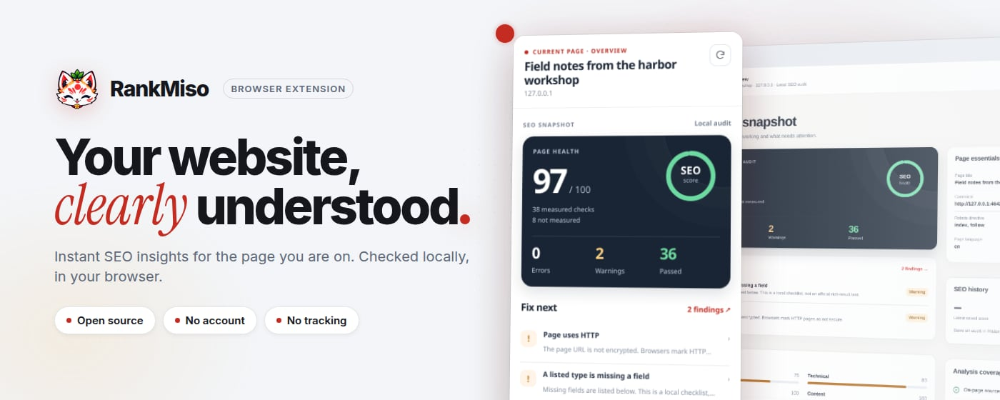
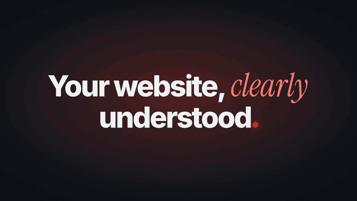
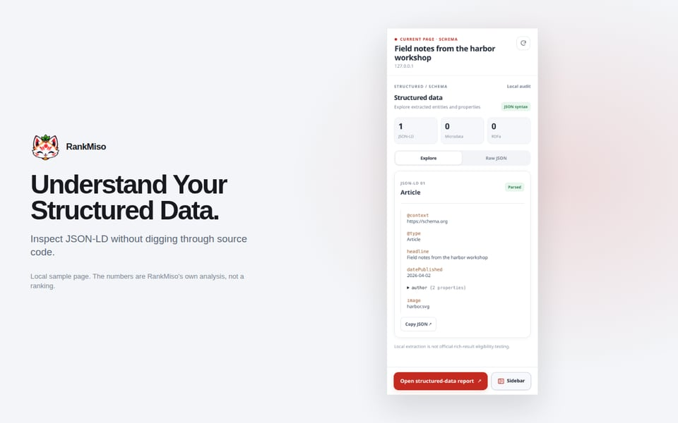
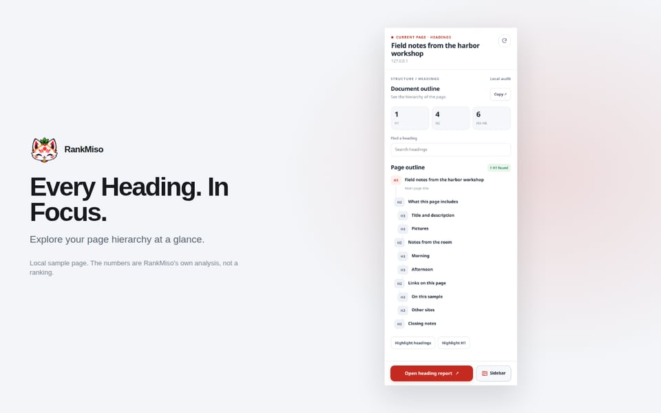
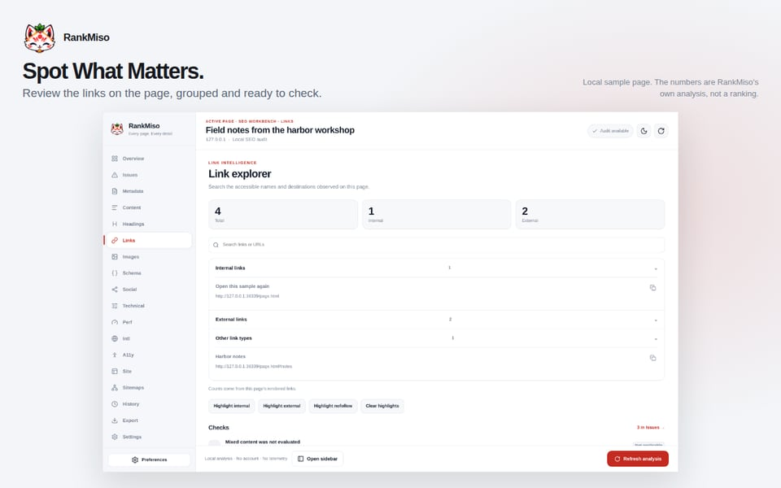
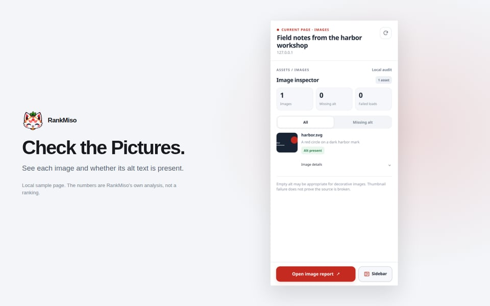
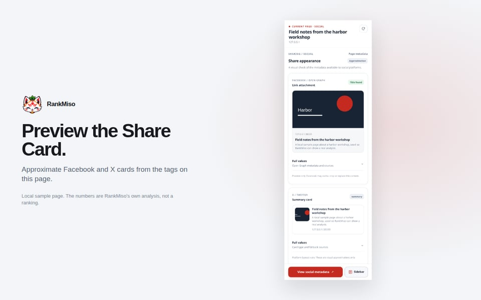
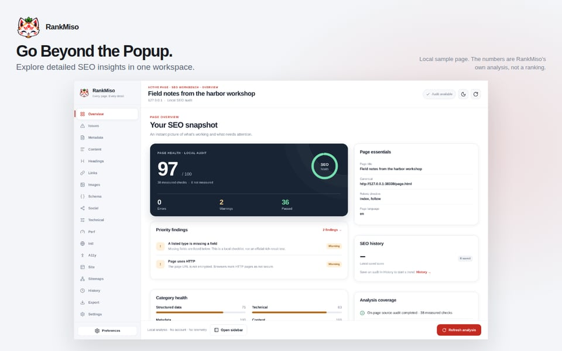
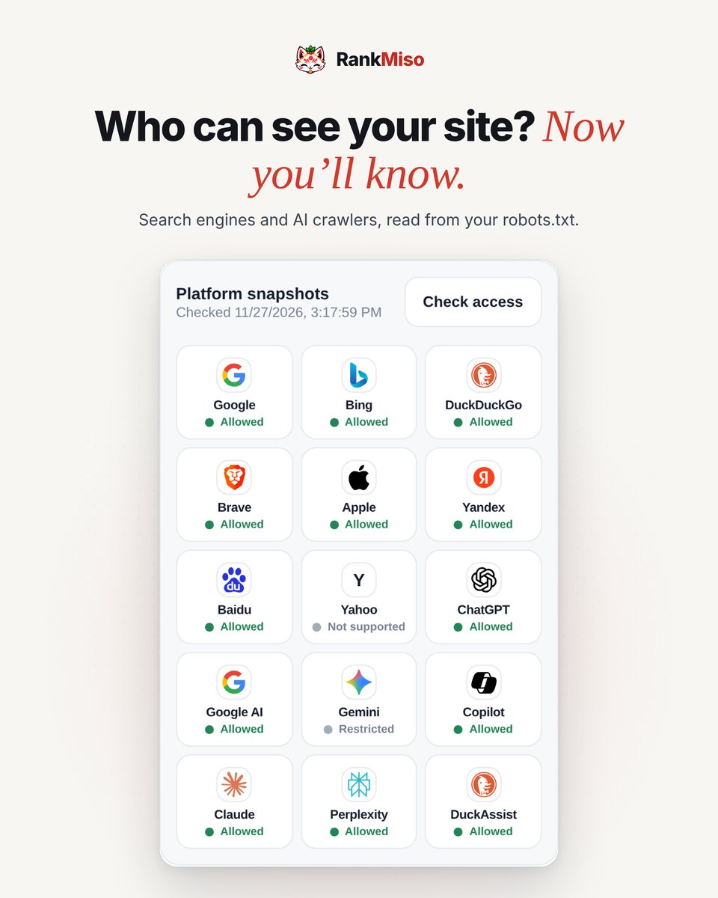

<p align="center">
  <picture>
    <source media="(prefers-color-scheme: dark)" srcset="docs/assets/readme/hero-dark.jpg" />
    
  </picture>
</p>

<h3 align="center">Every page. Every detail.</h3>

<p align="center">
  A free, open-source SEO browser extension with a fox's nose for detail.<br />
  Click the fox, read the page. No account, no subscription, no telemetry, no ads, no backend.
</p>

<p align="center">
  
  
  
  
  
</p>

---

## 🦊 Meet the fox

RankMiso is for developers, marketers, and anyone who owns a website. Open it on the page you are viewing. It reads that page **in your browser**, scores the checks it can actually measure, and shows the rest as *not measured*. No guessing, no made-up numbers.

<p align="center">
  
</p>

It belongs to the Miso ecosystem, where the recipe is simple: powerful tools, less overhead.

RankMiso is on the Chrome Web Store and Firefox Add-ons. Edge runs the Chromium build, sideloaded. Safari is not supported.

> [!NOTE]
> The current version is **v0.7.1**. The MCP companion (v0.5.1) and the Claude Code and Codex plugins are versioned separately; see the [integration guide](docs/integrations/README.md). Every version is in the [changelog](CHANGELOG.md).

## 🍜 What's in the bowl

The popup is the quick taste. The full report is one click away.

| | |
| --- | --- |
|  |  |
| **JSON-LD.** Labeled fields you can scan, plus a copy of the formatted source. | **Headings.** The whole outline, with copy on each heading. |
|  |  |
| **Links.** Internal, external, and nofollow, with addresses you can open. | **Images.** Thumbnail, bold name, then the image address. |
|  |  |
| **Social.** Approximate link and X cards, including the share image when it loads. | **Full report.** The same analysis, with room for the long tables. |

The **overview** puts the essentials up front: the score, priority findings, category health, page essentials, your saved history, and a Discoverability summary.

The full report is a workspace with a section for each part of the page: Issues, Metadata, Content, Headings, Links, Images, Schema, Social, Technical, Performance, International, and Accessibility. Under **Site intelligence** sit Site Explorer, Sitemaps, and Discoverability, followed by History, Export, AI Integrations, and Settings. JSON, CSV, and HTML exports download only after you confirm.

The little things are handled too. Counts use thousands separators, long addresses truncate, and web links open in a new tab. Light, dark, and system themes are all in the box.

## ✨ Fresh from the kitchen

New in v0.7.1:



- **Discoverability.** See how a page presents itself to search engines and AI-assisted search, in three tabs:
  - **Crawler access** reads robots.txt (RFC 9309) for 18 documented crawlers and tokens, from Google, Bing, DuckDuckGo, Brave, Apple, Yandex, and Baidu to ChatGPT, Gemini, Copilot, Claude, and Perplexity. It also reads indexing directives and Microsoft's AI training and grounding preferences. Nothing is fetched until you choose **Check access**.
  - **Content readiness** groups structure, clarity, attribution, structured data, and accessibility checks that matter for AI-assisted discovery. There is no made-up "AI score".
  - **Visibility** is your own log of AI answers you saw and recorded. RankMiso never queries AI services.
- **JavaScript SEO.** Compare the initial HTML with the rendered page on seven signals: title, description, canonical, robots, H1, internal links, and JSON-LD types.
- **Redirect trace.** Follow each redirect hop by hop. Detailed hops use an optional permission that is requested only when you choose **Allow redirect details**.
- **Canonical and hreflang relationships** across the pages a Site Explorer crawl analyzed.
- **Structured data checks** across JSON-LD, Microdata, and RDFa, with required properties taken from Google's documentation.

The page score is unchanged by these new findings. Earlier releases added Site Explorer, saved history, automatic and per-site website access, and AI sharing; see the [changelog](CHANGELOG.md).

### 🔍 Site Explorer

Point the fox at a website and press **Start crawl**. It stays on that one origin, follows robots.txt, and stops at 100 pages, depth 3, or two minutes. Watch the progress, press **Stop** whenever you like, and export the results.

The crawl gives you site-wide views: an Overview, Issues grouped by rule with the affected pages, Pages, and Links. It flags duplicate titles and descriptions and checks canonical and hreflang relationships between the pages it analyzed. Crawls are saved on your device, so you can compare one crawl with an earlier one. Partial crawls are labeled so they are never compared as if they were complete. Nothing crawls until you press Start, and your browsing history is never crawled.

### 📈 History

Save a report when you want a before and after. Saved comparisons stay on your device, and RankMiso only saves when you ask it to.

### 🤖 A Little AI Seasoning — RankMiso MCP

Share an audit with Claude Code or Codex and let your coding assistant explain it or fix the issues in your code. Everything runs locally through the RankMiso MCP companion. There is no Miso account or backend, and nothing is shared until you choose **Share with MCP** in the extension.

**Claude Code**

```text
/plugin marketplace add EdeesonOpina/rankmiso
/plugin install rankmiso@rankmiso
```

**Codex**

```sh
codex plugin marketplace add EdeesonOpina/rankmiso
codex plugin add rankmiso@rankmiso
```

Then ask your assistant to **Connect RankMiso** and approve the one-time setup. The plugin downloads the companion from the GitHub release, checks its SHA-256, installs it for your user, and registers Chrome and Firefox. You don't edit any config files. Restart Claude Code (or reconnect RankMiso in `/mcp`) or start a new Codex session, then share an audit from the extension.

| Environment | Status |
| --- | --- |
| Linux x86_64 with Google Chrome | Verified |
| macOS | Not yet tested on a Mac |
| Windows | Automatic plugin setup not supported yet; use the [manual install](docs/mcp/INSTALL.md) |
| Firefox sharing, including Snap Firefox | Not yet verified |

Your AI assistant may send the audit content it reads to its model provider, under that client's settings. Details: [Claude Code](docs/integrations/claude-code.md), [Codex](docs/integrations/codex.md), [how the plugin works](docs/integrations/README.md). Advanced: [manual companion install](docs/mcp/INSTALL.md) from [GitHub Releases](https://github.com/EdeesonOpina/rankmiso/releases/tag/v0.5.1).

> [!NOTE]
> Firefox doesn't have everything yet. Standalone sitemap discovery, PageSpeed Insights, the live HTML comparison, and some optional remote technical checks are Chromium only. See [browser compatibility](docs/browser-support/compatibility.md).

## 🎯 A score you can trust

The number is a weighted summary of the checks that ran. Errors, warnings, and passes are counted. Checks that could not be evaluated stay out of the score, so a missing measurement never sneaks in as a pass.

**The fox's oath.** RankMiso will not invent:

- search volume or keyword difficulty
- traffic or backlinks
- index status

A missing measurement is shown as unavailable. The result includes a disclaimer: this is not a Google ranking.

<details>
<summary><b>Optional checks that reach the network (off until you start them)</b></summary>

<br />

Chromium builds can run explicit optional site checks, sitemap discovery, the live HTML comparison, and Site Explorer. Firefox builds support user-started, same-origin Site Explorer crawling, Discoverability crawler access checks, and the redirect trace, and can compare an HTML file you choose; other optional remote technical checks and standalone sitemap discovery remain unavailable there.

Discoverability's **Check access** reads the site's robots.txt and the page once, from the same origin, without cookies. The redirect trace reads only RankMiso's own requests; the optional `webRequest` permission it uses is asked for only when you choose **Allow redirect details**.

The report also has a Sitemaps section. In Chromium it can read the sitemap files named by robots.txt, two common paths, or a URL you enter, after you allow that site. It does not fetch a sitemap on another host, and it does not crawl the listed pages. Firefox imports XML locally; its Site Explorer can read sitemap URLs only as part of a crawl you explicitly start.

Those requests stay off until you start them. Site Explorer is limited to the selected origin, follows robots.txt, uses bounded page/depth/time/request limits, omits credentials, and stops when requested or when its report closes. Automatic Checks do not start crawls.

The Performance section shows browser-observed LCP and CLS when available, plus an INP estimate from exposed event entries. These are not field data. Chromium builds offer an optional mobile PageSpeed Insights check that sends the page URL and a user-provided API key to Google only after explicit consent; its lab results do not affect RankMiso's score. Firefox omits this external check.

Reports can save comparison fields locally after you choose to save them. RankMiso still does not measure search rankings, traffic, backlinks, index coverage, or official rich-result eligibility. See [what the product includes](docs/features/overview.md).

</details>

## 🔐 Privacy first

The audit runs in your browser. No account, no telemetry, no RankMiso servers. Website access is optional and you have to grant it. Anything that touches the network waits until you start it. The details are in [PRIVACY.md](PRIVACY.md).

## 🍵 Keep Miso Brewing

RankMiso is free, open-source, and built with care. If you find it useful, visit the official [Sponsor Miso Ecosystem](https://github.com/sponsors/EdeesonOpina) profile to check current availability and support continued development. All RankMiso features remain free.

## 🚀 Take it for a spin

**Firefox**, from this repository:

```bash
source "$HOME/.cargo/env"
pnpm install
pnpm build:wasm
pnpm --filter @rankmiso/extension build:firefox
```

Open `about:debugging`, choose **This Firefox**, then **Load Temporary Add-on**. Select:

`apps/extension/.output/firefox-mv3/manifest.json`

Choose the file, not the folder. The add-on disappears when Firefox quits. After a rebuild, click **Reload** on that same entry.

**Chrome and Edge:**

```bash
pnpm --filter @rankmiso/extension build
pnpm --filter @rankmiso/extension build:edge
```

Load the unpacked folder `apps/extension/.output/chrome-mv3` or `apps/extension/.output/edge-mv3`. Safari is not produced by these commands.

## 🛠️ In the kitchen

Requirements: Rust stable, the `wasm32-unknown-unknown` target, `wasm-bindgen-cli` 0.2.100, Node.js 22+, and pnpm 10.

```bash
source "$HOME/.cargo/env"
pnpm install
pnpm build:wasm
pnpm dev
```

**Rust owns the rules. Vue owns the screen.** The Rust crates stay named `seo-core`, `seo-rules`, `seo-scoring`, and `seo-wasm`.

Want to help? Start with [CONTRIBUTING.md](CONTRIBUTING.md).

Store screenshots, promo tiles, and the images in this README come from the [marketing pipeline](marketing/README.md).

## 📚 Docs

- [What the product includes](docs/features/overview.md)
- Discoverability: [crawler access](docs/features/crawler-access.md), [content readiness](docs/features/content-readiness.md), and [AI answer visibility](docs/features/ai-visibility.md)
- [JavaScript SEO](docs/features/javascript-seo.md), [redirects](docs/features/redirects.md), [canonical and hreflang](docs/features/canonical-hreflang.md), and [structured data](docs/features/structured-data.md)
- [Site Explorer](docs/features/site-explorer.md), [sitemaps](docs/features/sitemaps.md), and [history](docs/features/history.md)
- [How the pieces fit](docs/architecture/overview.md)
- [Brand and the fox mark](docs/branding/overview.md)
- [Browser support](docs/browser-support/compatibility.md) and [permissions](docs/browser-support/permissions.md)
- [Release notes](CHANGELOG.md)
- [Privacy](PRIVACY.md)
- [Contributing](CONTRIBUTING.md)
- [Using the name and fox](TRADEMARKS.md)
- [Roadmap](docs/development/implementation-plan.md) and [MCP setup](docs/mcp/README.md).

## License

MIT. See [LICENSE](LICENSE). Made with care (and a little miso) by the Miso ecosystem.

<p align="center">
  
</p>
