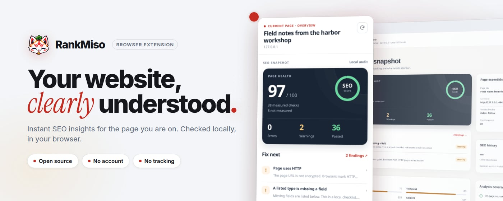
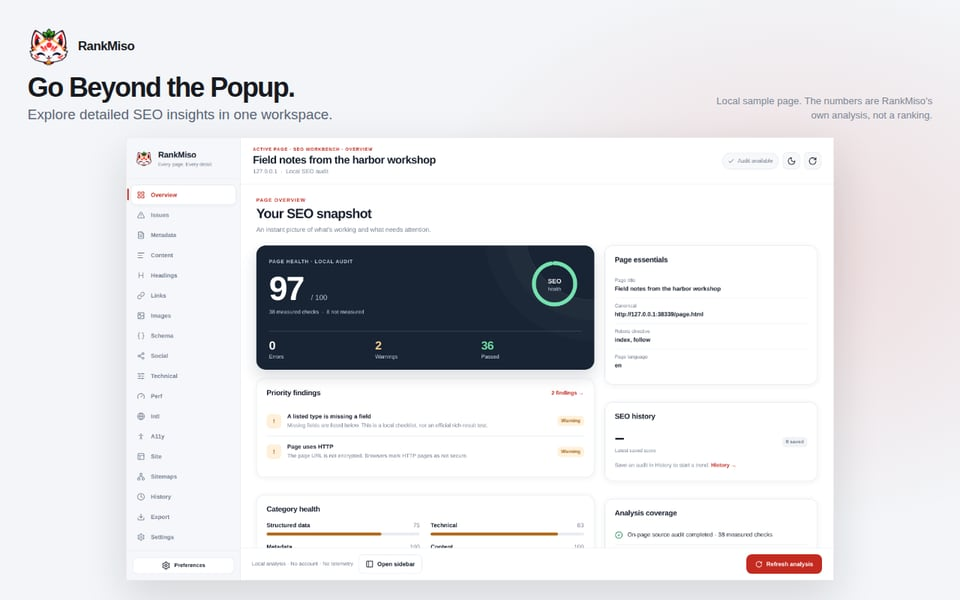
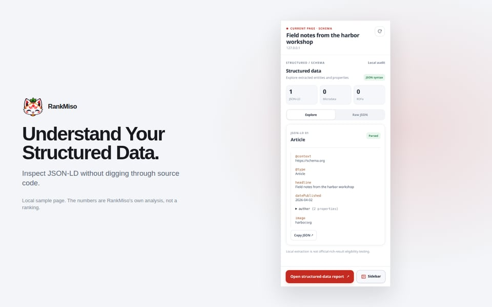

<p align="center">
  <picture>
    <source media="(prefers-color-scheme: dark)" srcset="../docs/assets/readme/hero-dark.jpg" />
    
  </picture>
</p>

# 📸 The RankMiso photo studio

This folder makes every RankMiso store picture. It photographs the real, built Chromium extension, then frames those captures for each store. It never touches the extension interface. The fox just poses.

The model page is `fixture/page.html`. Scores in the pictures come from RankMiso analyzing that page. They are not search rankings.

The rest of `fixture/` is a tiny local site around it: four more pages, a `robots.txt` that disallows `/drafts/`, and a `sitemap.xml` that also lists a missing page. Site Explorer and Sitemaps crawl it for real. For the History shot, the server briefly serves two earlier versions of `page.html` (shorter title, missing alt text) so the three saved measurements show a genuine change. The language shot reads `visit.html`, which declares hreflang alternates. The sidebar shot docks the real sidebar beside the sample page, styled for the picture only.

## 🎬 Lights, camera, capture

From the repository root, after the Chrome extension has been built:

```bash
pnpm --filter @rankmiso/extension build
pnpm marketing:capture
pnpm marketing:build
pnpm marketing:preview
pnpm marketing:validate
```

`pnpm marketing:generate` runs capture, composition, the preview gallery, and validation in one go.

To keep existing local builds, captures, and exports untouched while checking the pipeline, point all output roots at a new temporary directory:

```bash
RANKMISO_EXTENSION_OUT_DIR=/tmp/rankmiso-check/extension \
  pnpm --filter @rankmiso/extension build
RANKMISO_EXTENSION_OUT_DIR=/tmp/rankmiso-check/extension \
RANKMISO_MARKETING_CAPTURES_DIR=/tmp/rankmiso-check/captures \
RANKMISO_MARKETING_OUTPUT_DIR=/tmp/rankmiso-check/output \
pnpm marketing:generate
```

The fixture server serves only files listed in the local fixture set; it does not expose arbitrary paths from the checkout.

## 🖼️ What comes out

| Path                             | What it is                                                                                                                                                                                                                                                                  |
| -------------------------------- | --------------------------------------------------------------------------------------------------------------------------------------------------------------------------------------------------------------------------------------------------------------------------- |
| `marketing/captures/`            | Raw extension screenshots. Gitignored.                                                                                                                                                                                                                                      |
| `marketing/output/chrome/`       | 26 screenshots at 1280×800. The set includes Site Explorer Overview, Issues, Pages, Links, Compare, crawl controls, and dark mode. The store accepts five; 01–05 are the suggested set, and any later image can replace them. Also 440×280 and 1400×560 promotional images. |
| `marketing/output/firefox/`      | 23 frames at 1280×800 of the same interface. Shots marked `chromiumOnly` in `src/shots.ts` (technical HTML comparison, sitemap discovery, PageSpeed) are left out. Not captured inside Firefox.                                                                             |
| `marketing/output/safari/macos/` | The same 23 frames at 2880×1800. Provisional. The Mac listing can take up to ten.                                                                                                                                                                                           |
| `marketing/output/youtube/`      | 1280×720 YouTube thumbnail for the promo video, as PNG and JPG (both under YouTube's 2 MB limit).                                                                                                                                                                           |
| `marketing/output/seo/`          | 1200×630 share images for `og:image` and X cards: `share-light.jpg` and `share-dark.jpg`.                                                                                                                                                                                   |
| `marketing/output/preview.html`  | Local gallery. Open the file in a browser.                                                                                                                                                                                                                                  |

`SOURCE.txt` in each export folder says whether a native runtime was used.

iOS and iPadOS files are not created. RankMiso has no iPhone or iPad app. The sizes Apple lists for those devices are recorded in `src/platforms.ts` and left unused.

## ✨ Promo tiles and thumbnail

<p align="center">
  
  
</p>

`templates/promo.html` draws the 440×280 and 1400×560 Chrome promo images and the YouTube thumbnail. They share the look of the promo video: ink background, vermilion dot, Inter 800 with an Instrument Serif italic accent, and the real popup front and center. Both fonts are in `assets/fonts/` (SIL Open Font License) and are embedded at render time, so the output does not depend on fonts installed on the machine.

Each tile is rendered twice: dark (`promo-small.png`, `promo-marquee.png`) and light (`promo-small-light.png`, `promo-marquee-light.png`). The store takes one of each size, so upload whichever pair you prefer. The validator checks the dark pair.

### SEO share image

`pnpm marketing:build` also renders a 1200×630 JPEG of each marquee theme in `output/seo/` for link previews (Open Graph, X). Previews use 1.91:1 and the marquee is 2.5:1, so cropping or padding the marquee leaves empty space or cuts the headline. Instead `templates/promo.html` lays the same scene out again (`.marquee.share`) on a 1400×735 canvas with larger copy and a taller popup, and the result is scaled to 1200×630. The Miso website can use the light one as `public/brand/rankmiso-share.jpg`.

### Main README images

`docs/assets/readme/` holds tracked copies of a few outputs for the repository README: both marquees as `hero-*.jpg`, six screenshots, and `demo.gif`, the popup-click moment from the promo video. They are copied by hand, not by `pnpm marketing:build`. After a rebuild, refresh them from the repository root:

```bash
node -e '
const sharp = require("./marketing/node_modules/sharp");
const S = "marketing/output/chrome/", D = "docs/assets/readme/";
const jobs = [["promo-marquee.png", "hero-dark.jpg"], ["promo-marquee-light.png", "hero-light.jpg"],
  ["02-structured-data.png", "schema.jpg"], ["03-headings.png", "headings.jpg"], ["04-links.png", "links.jpg"],
  ["05-full-report.png", "full-report.jpg"], ["06-images.png", "images.jpg"], ["07-social.png", "social.jpg"]];
for (const [a, b] of jobs)
  sharp(S + a).resize({ width: a.startsWith("promo") ? 1400 : 960 }).jpeg({ quality: 84, mozjpeg: true }).toFile(D + b);'

ffmpeg -y -ss 3.85 -t 4.9 -i marketing/output/videos/rankmiso-promo-16x9.mp4 \
  -vf "hqdn3d=8:8:12:12,fps=12,scale=720:-1:flags=lanczos,split[a][b];[a]palettegen=max_colors=96:stats_mode=diff[p];[b][p]paletteuse=dither=none:diff_mode=rectangle" \
  docs/assets/readme/demo.gif
```

The denoise step matters: the film grain otherwise makes the GIF about three times larger.

## 🌐 Browsers

Chromium capture loads `apps/extension/.output/chrome-mv3`. A temporary copy receives host permission for `127.0.0.1` only, so the sample page can be read. The product manifest is not edited.

Firefox is installed on this machine. Playwright cannot drive that system Firefox without its own patched Firefox build, and the existing browser tests do not load the add-on. These Firefox images use the shared RankMiso interface and do not draw a Chrome window.

Safari images are compositions of that same interface at the Mac App Store size. They are not Safari screenshots. Check them in Safari before any Mac submission.

## 📏 Specs checked

28 October 2026.

- Chrome Web Store images: screenshots 1280×800, small promo 440×280, marquee 1400×560. Square corners, full bleed, no alpha.
- Firefox listing guidance: 1280×800 at a 1.6:1 ratio.
- Apple screenshot specifications: Mac 2880×1800 is an accepted 16:10 size. No alpha.
- YouTube thumbnail: 1280×720, under 2 MB.
- Share image (Open Graph, X large card): 1200×630, 1.91:1.
